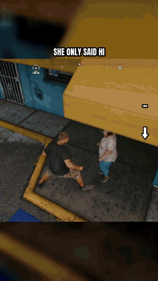
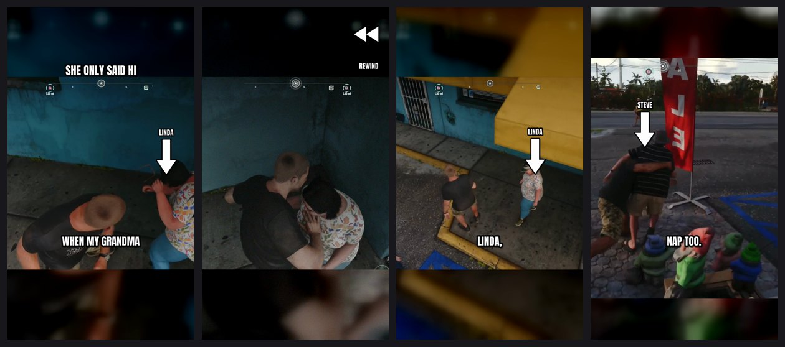

# gta6-meme-narrator

A Claude Code skill that turns a gameplay or stream clip into a narrated meme short. Claude watches the clip frame by frame, writes the jokes,
and renders a 1080x1920 video for YouTube Shorts, TikTok or Reels: it opens on the funniest moment, rewinds, then plays the whole thing while
a deadpan narrator gets everything hilariously wrong.

> "This kind man saw a fly on her shoulder and decided to get rid of it."
>
> "This is Brenda. Brenda saw nothing. Brenda is legally a lamp now."

<p align="center"></p>

**[Watch the whole short with sound](assets/demo.mp4)** (47 s). The skill made it from a GTA 6 stream clip with the wrong-name joke ("When my grandma was playing GTA 6"): game picture only, the clip's own sound muted (`--clip-volume 0`), so you hear Michael and the bundled sounds.



## What you get

- **A cold open:** the short starts in the middle of the action (the punch, the crash, the fail) with a hook on screen.
- **A rewind:** the cold open plays backwards at 4x with a VHS look and a record scratch, then the moment plays in full.
- **A narrator** with a free local voice (Kokoro, "Michael"): 6 to 12 deadpan lines that misread every action on purpose, give strangers
  names and backstories, and call every disaster a plan that worked. Optional wrong-name joke: "When Taylor Swift was playing GTA 6".
- **Arrows that follow things:** people, cars, the streamer's face, each with a label and a ding.
- **Freeze frames** with a zoom and a boom, **memes** from your own folder (cut in full screen or popped in a corner), **sound effects**
  (11 bundled, free to use).
- **The vertical layout:** facecam on top and the game below, or the game over a blurred copy when there is no facecam. All text white.

Made for GTA 6 clips, works with any game.

## Install

In Claude Code:

```
/plugin install gta6-meme-narrator --marketplace gabrielebolognese/gta6-meme-narrator
```

Older Claude Code, in two steps:

```
/plugin marketplace add gabrielebolognese/gta6-meme-narrator
/plugin install gta6-meme-narrator@gta6-meme-narrator
```

Without the plugin system: copy `skills/gta6-meme-narrator/` into `~/.claude/skills/`.

Then, once:

- **ffmpeg** (with libass): `winget install ffmpeg` on Windows, `brew install ffmpeg` on macOS, your package manager on Linux.
- **Python 3.10+ with Pillow**: `python -m pip install pillow`.
- **The voice**, Kokoro (free, local; Python 3.10 to 3.12): `python -m pip install kokoro soundfile`. Without it the narration renders as text.
- Optional, for captions of what the streamer says: `python -m pip install faster-whisper`.

## Use

Hand Claude a clip:

- "here's my GTA 6 clip, make it a funny narrated short"
- "meme this stream clip, use the wrong-name joke, my memes are in ./memes"
- "narrate this crash, make it at least 40 seconds"

Claude looks at every frame, writes the edit, checks that each arrow lands on its target, renders, looks at the result, and hands you
`short.mp4` with a title.

## How it works

```
python scripts/narrator.py frames clip.mp4 work/           # sheets of the clip's frames (one a second, a percent grid) for Claude
python scripts/words.py clip.mp4 work/                     # optional: the words said, with times
#   Claude writes work/edit.json (references/edit-format.md, references/comedy.md)
python scripts/narrator.py check clip.mp4 work/edit.json --work work/     # validates; work/layout.jpg shows the layout and every arrow point
python scripts/narrator.py render clip.mp4 work/edit.json out/ --python <python with kokoro>
```

`render` writes `out/short.mp4`, `out/keys.jpg` (the short's key moments, to check) and `out/plan.json` (the timeline). Options:
`--memes DIR`, `--voice am_michael` (any Kokoro voice, or `none`), `--speed 1.1`, `--clip-volume 1` (0 mutes the clip's own sound, for
copyrighted music), `--min-seconds 30`, `--max-seconds 59`, `--words work/words.json`. Under the minimum length the window grows and a slow replay of the peak is added.

**Your memes:** put short video clips and sounds in a folder and pass `--memes DIR`. The file name is the id; an optional `memes.json` in
the folder describes them (`{"rock-eyebrow": "The Rock raises an eyebrow"}`), so Claude knows when to use each.

**The bundled sounds:** ding, boom, whoosh, record scratch, pop, buzzer, boing, glitch, sad trombone, air horn, dun dun duun. All synthesized
from scratch by `scripts/make_sfx.py`, so they are yours to use anywhere (CC0).

## Test

```
python skills/gta6-meme-narrator/tests/selftest.py
```

Makes a synthetic clip, writes an edit, and runs every step (no footage and no voice model needed, about two minutes).

## License

MIT. The fonts (Anton, Archivo Black) are under the SIL Open Font License, the sounds are CC0; see NOTICE. Not affiliated with Rockstar Games
or Take-Two Interactive; GTA is their trademark. Use footage you have the right to use.
